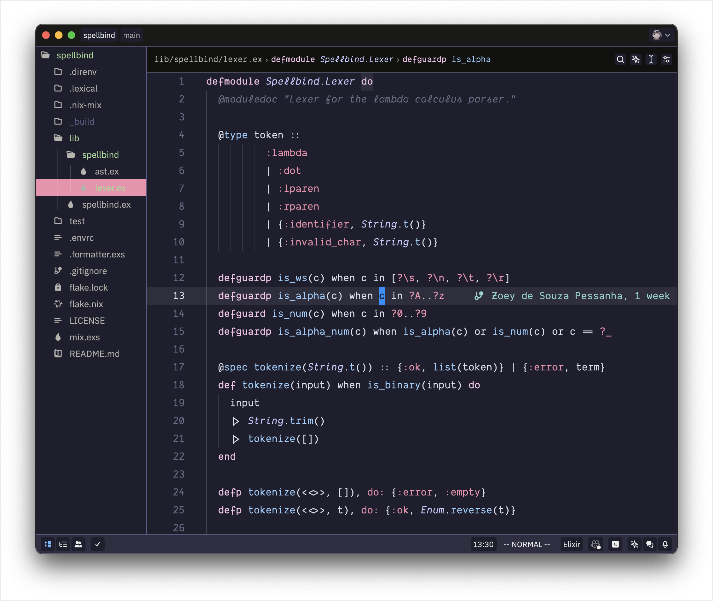
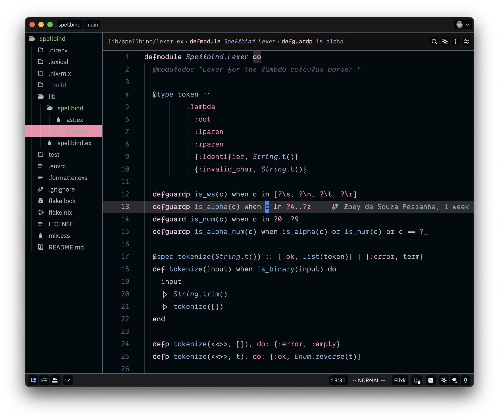
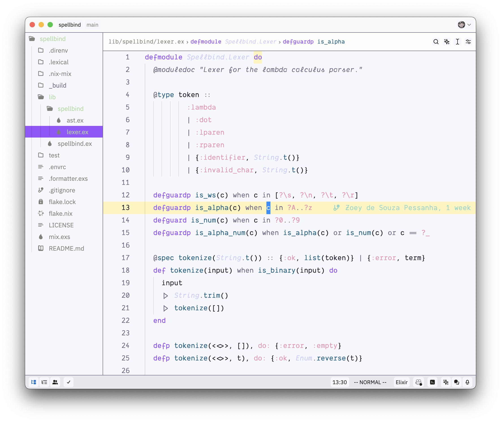

# nyxvamp (zed)

a minimalist theme collection, inspired by a blend of gothic and emo aesthetics with transfem symbolism. it combines deep purples and soft yellows with neutral tones to create strong contrasts and a comfortable coding environment that reflects individuality.

## variations

1. **veil**: versatile theme for both day and night, featuring bright accents on a dark background.

2. **obsidian**: dark theme for focused nighttime coding sessions.

3. **radiance**: light theme optimized for daylight use, ensuring excellent readability.

4. **jhujuba**: pink-tinted mid-dark theme, sweeter than veil.

## usage

1. downloads files

- `nyxvamp.json` (contains all variants)

2. place into the zed themes directory

- unix: `~/.config/zed/themes/`

3. issue the theme

- open zed
- open theme picker (cmd+k+t)
- type nyxvamp and choose your variant

## contribution

if you have suggestions or improvements, feel free to contribute or reach out.
